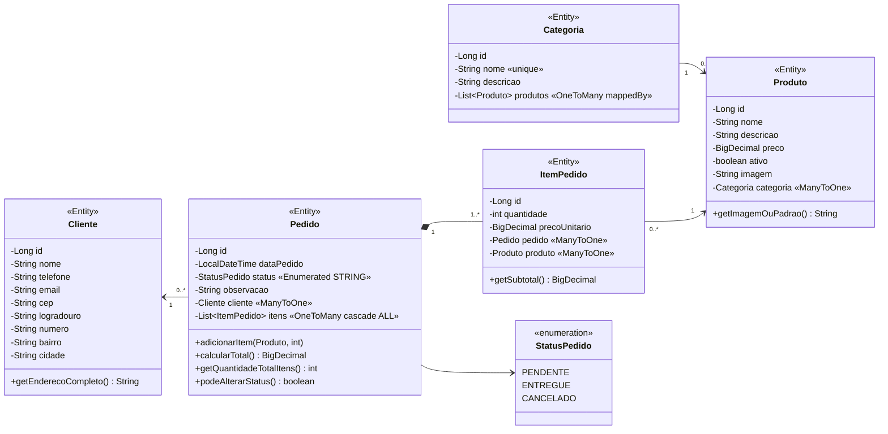
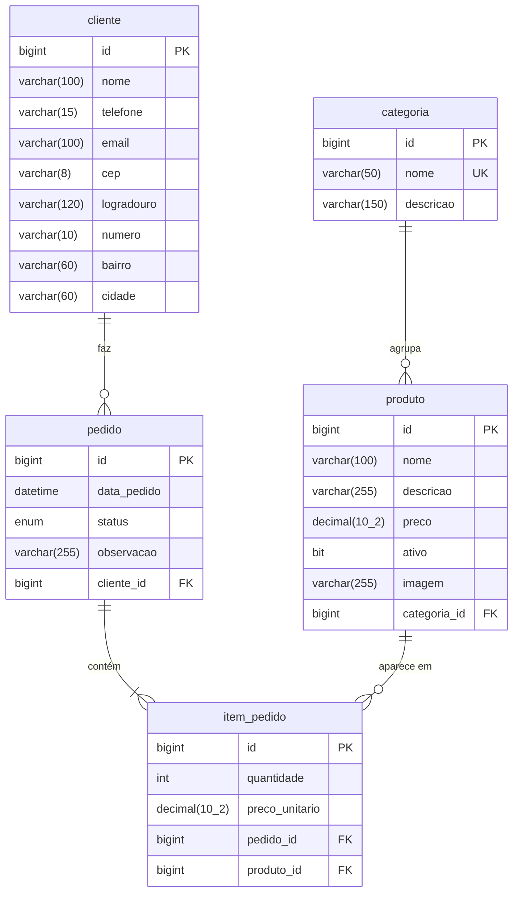

# 🥧 Empadas da Bia — Sistema Web (Spring)

Versão web do sistema de gerenciamento da **Empadas da Bia**: cardápio, clientes e pedidos.
Feito com **Spring Boot (Spring MVC + Thymeleaf + Spring Data JPA)** e **MySQL**, reaproveitando as
entidades, as regras de negócio, os diagramas e os protótipos do projeto em Java Swing.

### Integrantes

- [Nome do integrante 1]
- [Nome do integrante 2]

---

## ✅ Funcionalidades

| Módulo | O que faz |
|---|---|
| **Início** | Pedidos de hoje, pendentes, faturamento do mês, clientes, produtos ativos, últimos pedidos e as 3 empadas mais pedidas da semana |
| **Categorias** | Cadastrar, listar, editar e excluir. Nome único. **Não exclui categoria com produtos** |
| **Produtos** | Cardápio em cartões com foto, filtro por categoria e busca. Cadastro com upload de foto. Ativar/desativar. **Produto já vendido não é excluído: é desativado** |
| **Clientes** | Cadastrar, listar, buscar (nome, telefone ou e-mail), editar e excluir. Máscara de telefone/CEP e endereço preenchido pelo CEP. **Cliente com pedidos não é excluído** |
| **Pedidos** | Novo pedido com comanda (+ / −, total ao vivo), edição de pedidos pendentes, detalhes, filtro por cliente e status. **Marcar como entregue** ou **cancelar** (o pedido cancelado continua no histórico) |

Regras de negócio herdadas do Swing:

- Pedido exige **cliente** e **pelo menos 1 item**; produto repetido soma a quantidade.
- `ItemPedido` guarda o **preço do momento da venda**: mudar o preço do produto não altera pedidos antigos.
- O **total não é coluna**: é calculado por `Pedido.calcularTotal()`.
- Só pedidos **pendentes** podem ser editados, entregues ou cancelados.
- Telefone com DDD (10 ou 11 dígitos), e-mail e CEP validados; preço maior que zero.

O layout é **responsivo**: no celular o menu vira uma gaveta, as tabelas viram cartões e o Novo Pedido ganha uma barra fixa com o total.

---

## 🛠️ Tecnologias

| | |
|---|---|
| Linguagem | Java 25 |
| Framework | Spring Boot 4.1 (Spring MVC, Spring Data JPA, Bean Validation, DevTools) |
| Telas | Thymeleaf (fragmentos de layout), HTML, CSS e JavaScript puro |
| Banco | MySQL 8.4 (tabelas criadas pelo Hibernate a partir das `@Entity`) |
| Build | Maven (wrapper `mvnw` incluso — não precisa instalar o Maven) |
| Testes | JUnit 5 |

---

## 🏛️ Arquitetura (MVC)

```
Navegador ──► Controller ──► Service ──► Repository ──► MySQL
                  │
                  └──► View (Thymeleaf) ◄── dados voltam pelo mesmo caminho
```

| Camada | Pacote / pasta | Responsabilidade |
|---|---|---|
| **Model — Entity** | `model` | Classes `@Entity` que viram tabelas (`Categoria`, `Produto`, `Cliente`, `Pedido`, `ItemPedido`, enum `StatusPedido`) |
| **Model — Repository** | `repository` | Interfaces `extends JpaRepository`: o Spring Data gera o SQL pelos nomes dos métodos e pelas `@Query` |
| **Model — Service** | `service` | Regras de negócio (`@Service`, `@Transactional`). É o único lugar que usa os Repositories |
| **Control** | `controller` | `@Controller`: recebe a URL, chama o Service e escolhe a tela. **Nenhum Controller acessa Repository** |
| **View** | `templates`, `static/css`, `static/js` | Telas Thymeleaf; `fragments/layout.html` tem o menu e o cabeçalho comuns |

Pacotes de apoio: `dto` (dados do formulário de pedido e do ranking), `config` (conversor de categoria,
pasta de uploads e carga dos dados de exemplo) e `util` (formatação de moeda, data, telefone e CEP).

```
src/main/java/br/com/empadasdabia/empadasweb
├── EmpadasWebApplication.java
├── model/        Categoria, Produto, Cliente, Pedido, ItemPedido, StatusPedido
├── repository/   CategoriaRepository, ProdutoRepository, ClienteRepository, PedidoRepository, ItemPedidoRepository
├── service/      CategoriaService, ProdutoService, ClienteService, PedidoService, DashboardService, ImagemService
├── controller/   InicioController, CategoriaController, ProdutoController, ClienteController, PedidoController
├── dto/  config/  util/
src/main/resources
├── application.properties
├── templates/    index, error, fragments/layout, categorias/, produtos/, clientes/, pedidos/
└── static/       css/estilo.css, js/app.js, img/
```

---

## 📐 Diagrama de classes



## 🗄️ MER (tabelas criadas pelo Hibernate)



---

## 🖼️ Protótipos e telas

**Protótipos (link):** https://claude.ai/artifact/L1gpKNLaUjhdoEw3ZjTgzd

| | |
|---|---|
|  **1. Início** |  **2. Pedidos** |
|  **3. Novo pedido (comanda)** |  **4. Detalhes do pedido** |
|  **5. Cardápio** |  **6. Cadastro/edição de produto** |
|  **7. Categorias** |  **8. Clientes** |
|  **9. Cadastro/edição de cliente** |  **10. Versão celular** |

---

## ▶️ Como executar

**Pré-requisitos:** JDK 21 ou superior (o projeto usa 25) e MySQL 8 rodando em `localhost:3306`.

1. Ligue o MySQL.
2. Se o seu usuário/senha do MySQL não for `root`/`root`, ajuste em
   `src/main/resources/application.properties` (ou defina as variáveis de ambiente `DB_USER` e `DB_PASSWORD`).
3. Rode a aplicação de um destes jeitos:
   - **IntelliJ:** abra a pasta do projeto e execute a classe `EmpadasWebApplication`;
   - **Terminal:** `mvnw spring-boot:run` (Windows) ou `./mvnw spring-boot:run` (Linux/Mac);
   - **Windows:** dois cliques em `executar.bat`.
4. Abra **http://localhost:8080**

Não é preciso rodar script SQL:

- `createDatabaseIfNotExist=true` cria o banco `empadas_web` sozinho;
- `ddl-auto=update` faz o Hibernate criar as 5 tabelas a partir das classes `@Entity`;
- na primeira execução (banco vazio) são carregados **dados de exemplo** — 4 categorias, 9 produtos,
  8 clientes e 15 pedidos — para o sistema já abrir com informação. Para desligar: `app.dados-exemplo=false`.

Para começar do zero: `DROP DATABASE empadas_web;` e rode a aplicação de novo.

Testes automatizados (regras do Model, não precisam do banco): `mvnw test`

---

## 💬 Perguntas frequentes

| Pergunta | Resposta |
|---|---|
| Por que o Controller não acessa o Repository? | As regras ficam no Service; o Controller só recebe a requisição e devolve a tela. |
| Onde está o SQL? | O Spring Data gera a partir dos métodos do Repository, e o Hibernate cria as tabelas a partir das Entities. |
| Por que `item_pedido`? | Um pedido tem vários produtos e um produto está em vários pedidos (N:N). |
| Por que `cascade = ALL` em Pedido? | O item não existe sem o pedido: salvar o pedido salva os itens juntos. |
| Por que `@Transactional`? | Para o pedido e os itens serem gravados juntos ou nenhum ser gravado. |
| Por que cancelar em vez de excluir? | Para manter o histórico de vendas. |
